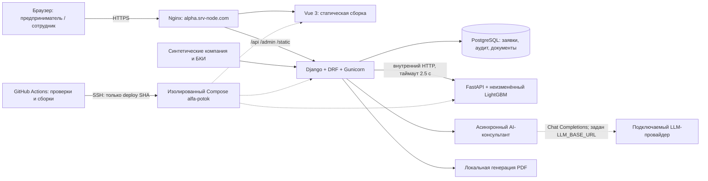
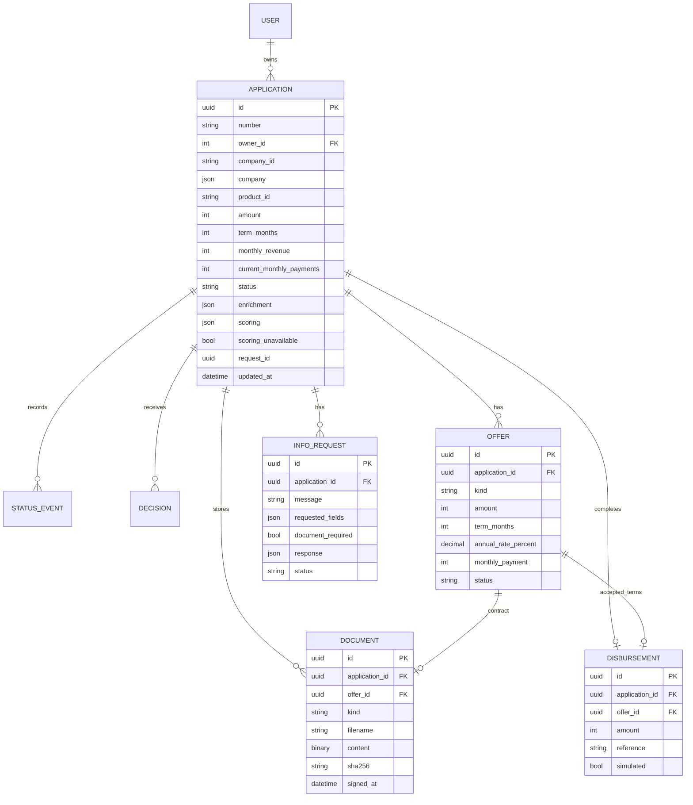

# Архитектура и модель данных

Команда ITigers. Одна компания на демо-профиль, четыре кредитных
продукта, клиент и андеррайтер, сквозной путь до демонстрационной выдачи.
Технические администраторы работают отдельно через Django Admin.

ML оценивает риск; Django применяет отдельную политику и управляет статусами.
AI-консультант подбирает продукт по описанию задачи и передаёт параметры
в форму заявки. LLM-вызовы включаются отдельно; по умолчанию используются
базовые параметры ответа без обращения к провайдеру.
Стоп-фактор или score < 520 → отказ. Score ≥ 620 и сумма не выше доступного
лимита → одобрение. Остальное и недоступность ML → сотрудник. Предложение
хранится отдельно от исходного запроса: при встречных условиях исходные
сумма/срок остаются в заявке, выдача использует принятую сумму оффера.

Вспомогательные модели: StatusEvent (переход, роль, сообщение, время), Decision
(вердикт, причина, роль, итоговый статус), стандартные User и DRF Token.
Компания, продукты и статьи — синтетические справочники; в заявке сохраняется
снимок компании. Уникальные ограничения: один pending-оффер, один открытый
дозапрос, один договор на оффер, одна выдача на заявку и на оффер.

## Надёжность и доступ

- Владелец проверяется при каждом обращении; банковские операции требуют роли bank.
- Score/PD и внутренние проверки доступны сотруднику, клиенту — объяснение и следующее действие.
- Статус изменяет сервер. PATCH доступен только черновику; сравнение updated_at защищает от устаревшей записи.
- Внешний вызов ML выполняется вне транзакции записи. request_id связывает ответ с запуском.
- Повторные submit/accept/sign не создают повторную оценку, договор или выдачу после завершения действия.
- Документы: PDF/XLSX, до 10 МиБ, до 6 вложений. Файлы не исполняются и не распознаются; проверяются тип/структура/макросы и принадлежность. Скачивание — только через авторизованный API.
- Хранение PDF/XLSX в PostgreSQL выбрано для переносимого MVP и согласованных резервных копий. Для нагрузки нужны объектное хранилище, антивирус, PostgreSQL и очередь задач.
- Перед деплоем создаётся PostgreSQL backup. Неуспешная проверка запуска возвращает предыдущие образы, compose и БД.
- Контейнер ML без внешнего порта; лимиты памяти/CPU и один поток. Собственная сеть Compose и отдельный домен защищают соседние проекты от изменений конфигурации.

## Режим работы и интеграции

DEMO_MODE включает готовые профили для проверки клиентского и банковского
процесса. ФНС/ЕГРЮЛ/БКИ представлены тестовыми наборами данных.
Подписание и выдача в этом режиме смоделированы. PostgreSQL хранит заявки,
историю, офферы и документы в одной согласованной базе. Сервис ML подключён
через отдельный HTTP-контракт; развёртывание управляется Docker Compose.
