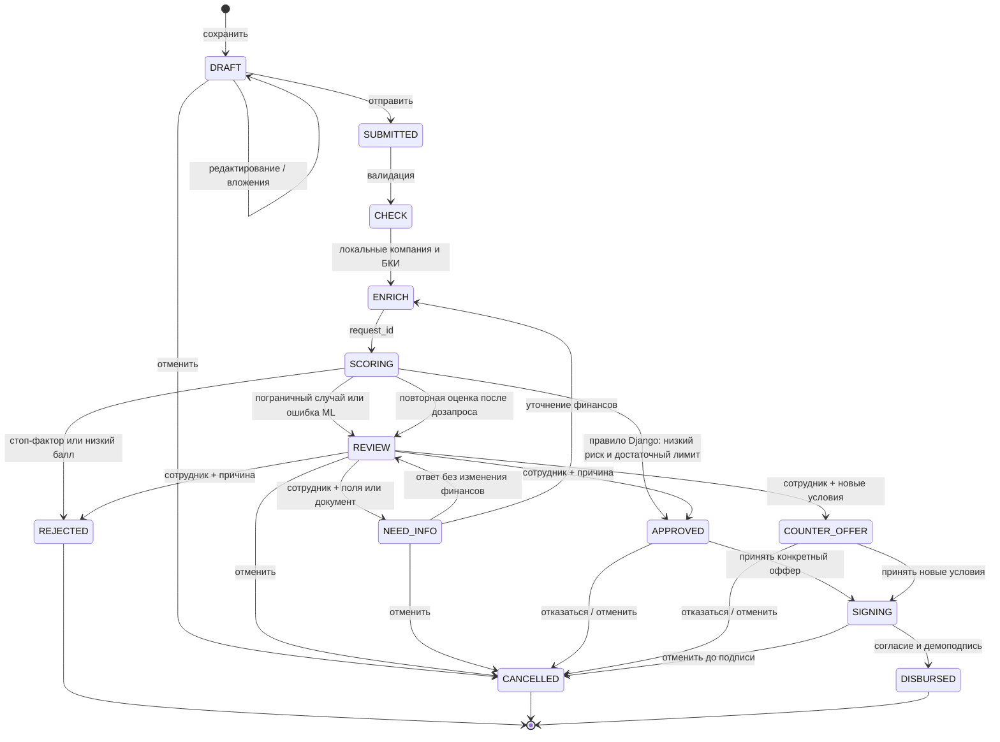

# Состояния заявки

После дозапроса решение всегда возвращается сотруднику, даже если повторный
ML-результат хороший. История, вложения, первоначальные параметры и ответ
сохраняются. Уточняются выручка и текущие кредитные платежи; продукт/сумма/срок
на этом шаге не меняются. Для других условий сотрудник создаёт встречный оффер.

Восстановление: SCORING старше 30 секунд можно повторить через submit;
новый request_id блокирует запоздавший результат предыдущего запуска.
Терминальные результаты не оцениваются повторно. DISBURSED означает только
смоделированную выдачу, повторная подпись возвращает ту же операцию.

Неподходящий статус даёт HTTP 409; чужая заявка/документ — 404, другая роль —
403, невалидные данные — 400. Нельзя произвольно задать status через PATCH.
